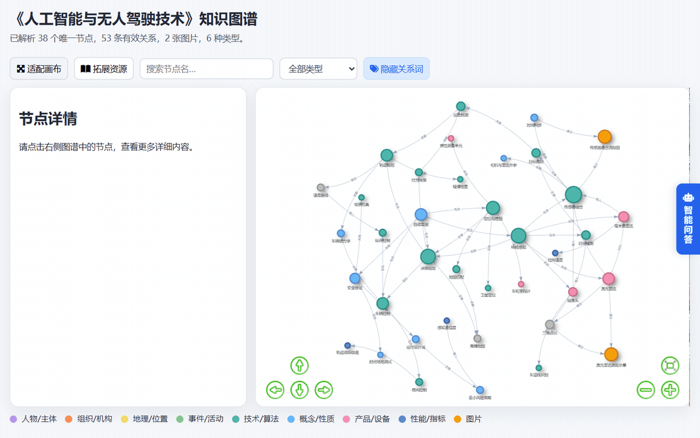
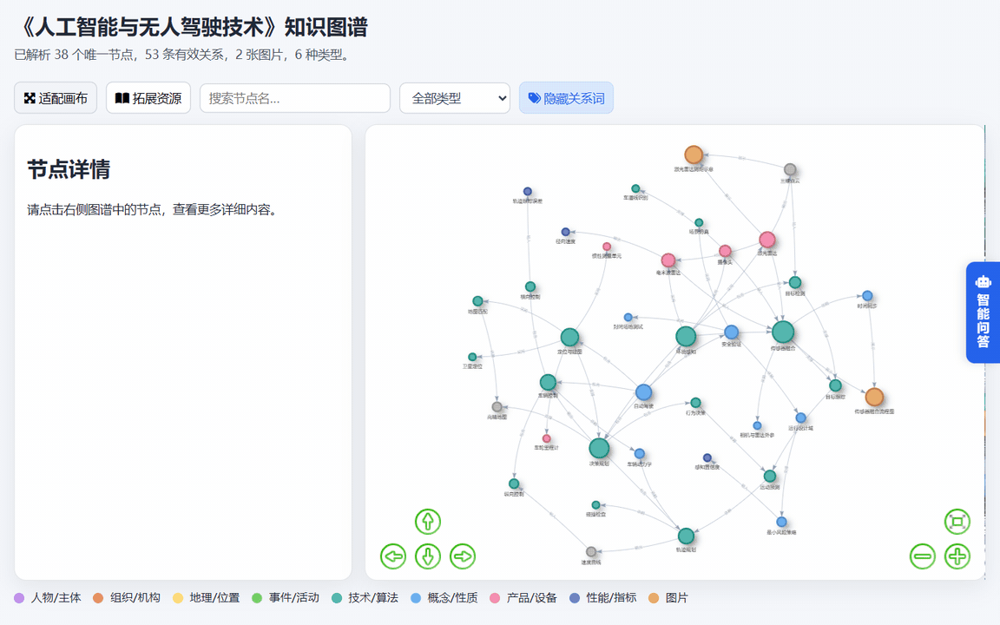

# GraphRAG Teaching Assistant

An intelligent teaching assistant powered by **knowledge graphs and generative AI**. The included autonomous-driving lesson connects vehicle perception, localization, planning, control, and safety so learners can explore concepts and ask questions about the relationships between them.

## Interactive Demos / 交互演示（部分展示）

### Knowledge Graph Exploration / 知识图谱探索

Search for LiDAR to focus on its immediate neighbours. The detail panel explains the selected concept and shows an illustration of how laser ranging works.

<picture>
  <source type="image/avif" srcset="assets/demos/knowledge-graph-exploration.avif">
  
</picture>

### Graph-Grounded Q&A / 图谱问答

Ask how LiDAR and millimetre-wave radar complement each other. The assistant retrieves related graph evidence, generates an answer with Qwen, and lets you select an evidence chip to jump to the corresponding node.

<picture>
  <source type="image/avif" srcset="assets/demos/graph-grounded-qa.avif">
  
</picture>

## Quick Start

Use Python 3.12 for the verified setup. The interface is in Chinese.

### Windows

1. Clone this repository or download it from GitHub.
2. Run `setup.bat` to install the dependencies in a virtual environment and create `.env`.
3. Run `start.bat`, then open [the local application](http://127.0.0.1:8000).

### macOS and Linux

Run these commands from the checkout.

```bash
python3 -m venv .venv
source .venv/bin/activate
python -m pip install -r requirements.txt
cp .env.example .env
python scripts/verify_project.py
python main.py
```

Open [the local application](http://127.0.0.1:8000). Search for `激光雷达` (LiDAR), open **智能问答**, and try `激光雷达和毫米波雷达如何互补？` (“How do LiDAR and millimetre-wave radar complement each other?”).

### Enable Generative and Visual Q&A

Graph browsing and local evidence retrieval work with an empty API key. To enable Qwen generation and multimodal retrieval, put your DashScope key in the local `.env` file and restart the service.

```dotenv
DASHSCOPE_API_KEY=
```

In this mode, the app sends questions and selected evidence to DashScope. It can analyse relevant images for visual questions. The browser loads PDF.js when you attach a PDF to extract text from its first eight pages. The explorer and text-only interface load their browser libraries locally.

## Data and Architecture

The repository includes a self-contained example with **38 nodes, 53 relationships, 6 text passages, and 2 diagrams**. These assets were written and drawn for the example. The original course corpus, reference PDFs, and local credentials are stored separately.

| Path | Contents |
| --- | --- |
| `main.py` | FastAPI entry point, GraphML and media endpoints, streaming chat |
| `rag/` | Graph normalization, retrieval, evidence selection, and DashScope integration |
| `static/` | Graph explorer and chat interface |
| `data/` | Example GraphML, source passages, and diagrams |
| `scripts/` | Windows setup, dataset verification, and optional snapshot import |

You can point `DATA_DIR` at your own dataset with the same directory layout. Place reference PDFs you have permission to use under `static/resources/papers/`, `static/resources/books/`, or `static/resources/patents/` to show them in the resource panel. The app listens on loopback by default. Graph write-back is opt-in via `ALLOW_GRAPH_WRITE=true`. See [architecture and data flow](docs/ARCHITECTURE.md).
