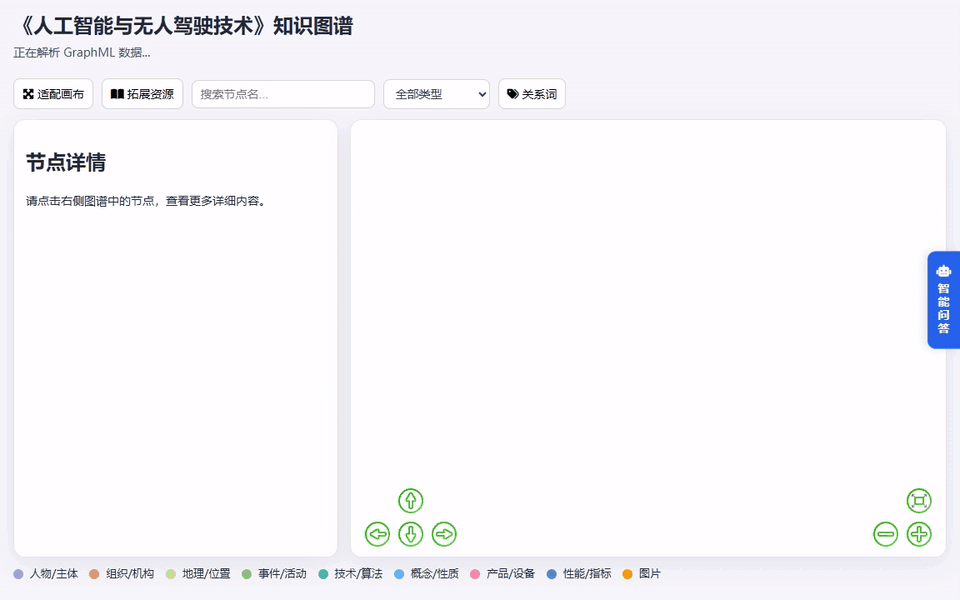
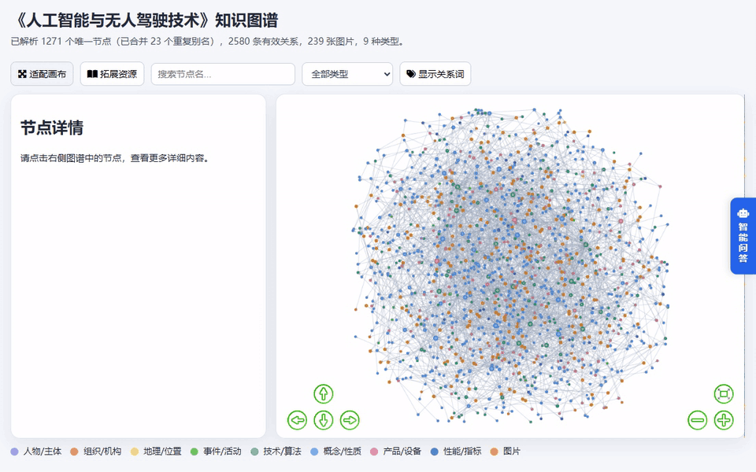

# GraphRAG Teaching Assistant

An intelligent teaching assistant powered by **knowledge graphs and generative AI**. The full course graph connects concepts in artificial intelligence and autonomous driving. Learners can explore relationships, inspect course figures, and ask questions grounded in the graph.

> While the manuscript and related work are in preparation, this repository shares selected code and highlights the project's progress. We will consider releasing the full codebase as open source after the paper is published.

## Interactive Demos / 交互演示（部分展示）

### Knowledge Graph Exploration / 知识图谱探索

The platform visualizes the output of a multimodal graph-construction pipeline that uses trained models to process **241 pages of heterogeneous course slides** on artificial intelligence and autonomous driving. MinerU extracted text and figures from the slides. A language model extracted entities and relationships from the text, and a vision-language model turned the figures into scene graphs. The pipeline aligned related entities across the two sources using semantic embeddings, relationship-aware spectral clustering, and model-based validation. The exported GraphML contains **1,294 nodes and 2,589 edges**. After normalization, the explorer displays **1,271 unique nodes** (1,032 non-image entities and 239 figure nodes) and **2,580 relationships**.

This repository provides the exported graph and its interactive visualization. The graph-construction pipeline and its model configuration have not been open-sourced in this repository.

Open the graph and select **Fit Canvas** to bring the entire network into view. Search for LiDAR to focus on its immediate neighbors, then open a linked figure from the course slides.

<picture>
  <source type="image/avif" srcset="assets/demos/knowledge-graph-load-and-search.avif">
  
</picture>

### Graph-Grounded Q&A / 图谱问答

Ask how LiDAR helps an autonomous vehicle perceive its surroundings. Read the answer generated by Qwen4-Max from the retrieved graph evidence, then select a matched entity to open its description in the left-hand detail panel.

<picture>
  <source type="image/avif" srcset="assets/demos/qwen4-max-graph-qa.avif">
  
</picture>

## Quick Start

Use Python 3.12 for the verified setup. The interface is in Chinese.

### Windows

1. Clone this repository or download it from GitHub.
2. Run `setup.bat` to install the dependencies in a virtual environment and create `.env`.
3. Run `start.bat`, then open [the local application](http://127.0.0.1:8000).

### macOS and Linux

Run these commands from the checkout.

```bash
python3 -m venv .venv
source .venv/bin/activate
python -m pip install -r requirements.txt
cp .env.example .env
python scripts/verify_project.py
python main.py
```

Open [the local application](http://127.0.0.1:8000). Search for `激光雷达 (LiDAR)`, open **智能问答**, and try `激光雷达如何帮助自动驾驶汽车感知环境？` (“How does LiDAR help an autonomous vehicle perceive its surroundings?”).

### Enable Generative and Visual Q&A

Graph browsing and local evidence retrieval work with an empty API key. Online answer generation and image understanding use **Qwen4-Max** through Alibaba Cloud Model Studio. Add your DashScope key to the local `.env` file and restart the service. If you are upgrading from an earlier checkout, update both model settings in your existing `.env`. [Qwen4-Max documentation](https://help.aliyun.com/en/model-studio/qwen4-max)

```dotenv
DASHSCOPE_API_KEY=
TEXT_MODEL=qwen4-max
MM_MODEL=qwen4-max
```

In this mode, the app sends questions and selected evidence to DashScope. It can analyse relevant images for visual questions. The browser loads PDF.js when you attach a PDF to extract text from its first eight pages. The explorer and text-only interface load their browser libraries locally.

## Data and Architecture

The repository includes the full course GraphML snapshot, **239 linked figures**, and **14 text chunks** used as retrieval evidence. The viewer loads the exported snapshot directly. The source courseware PDF is maintained separately.

| Path | Contents |
| --- | --- |
| `main.py` | FastAPI entry point, GraphML and media endpoints, streaming chat |
| `rag/` | Graph normalization, retrieval, evidence selection, and DashScope integration |
| `static/` | Graph explorer and chat interface |
| `data/` | Full course GraphML, text chunks, image metadata, and linked figures |
| `scripts/` | Windows setup, dataset verification, and optional snapshot import |

You can point `DATA_DIR` at your own dataset with the same directory layout. Place reference PDFs you have permission to use under `static/resources/papers/`, `static/resources/books/`, or `static/resources/patents/` to show them in the resource panel. The app listens on loopback by default. Graph write-back is opt-in via `ALLOW_GRAPH_WRITE=true`. See [architecture and data flow](docs/ARCHITECTURE.md).
