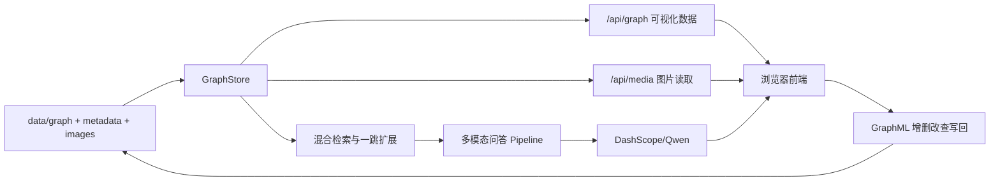

# GraphRAG 架构说明

## 设计目标

GraphRAG 采用训练与展示解耦的结构。训练系统可以生成快照，展示系统使用快照独立运行。仓库附带原创自动驾驶示例数据供启动和演示，也可以通过 `DATA_DIR` 加载同结构的数据目录。运行时模块不搜索相邻目录，也不导入训练工程代码。

## 数据流

## 后端边界

- `main.py`：HTTP 边界、上传、流式响应、图谱写回、健康检查。
- `rag/config.py`：唯一配置入口；默认路径全部位于项目 `data` 目录。
- `rag/graph_store.py`：加载 GraphML，合并带引号/不带引号的重复实体，规范实体类型和短关系词，解析本地图片。
- `rag/embedding_store.py`：先做低成本本地召回，再对少量候选调用多模态向量模型；缓存以内容哈希失效。
- `rag/retriever.py`：组合实体分数、一跳邻居、关系证据、文本块和动态图片候选。
- `rag/pipeline.py`：图片理解、检索、视觉证据分析、答案流式生成和无 Key 降级。
- `rag/llm.py`：模型服务适配层。
- `rag/prompts.py`：线上实际使用的提示词；项目中不保留多套未引用提示词副本。

## 前端边界

`static/index.html` 是当前唯一页面入口，包含：

- vis-network 图谱绘制；
- 搜索、筛选、关系标签和详情面板；
- 节点/关系增删改查；
- 文字、图片和附件问答；
- 自适应逐帧物理模拟：运动时唤醒，稳定后休眠；
- 论文、书籍、专利资源面板。

`static/vendor` 保存图谱、文字问答和界面图标所需的前端库。PDF 附件功能按需从 jsDelivr 加载 PDF.js，再在浏览器中提取文本。拓展资源页列出 `static/resources/{papers,books,patents}` 中提供的 PDF。

## 数据目录约束

- `data/graph`：唯一正式 GraphML。
- `data/metadata`：图片元数据和文本块。
- `data/images`：知识图谱引用图片；元数据必须使用 `data/images/<文件名>`。
- `data/cache`：可删除、可重建的向量缓存。
- `data/uploads`：用户临时上传。
- `data/backups`：前端写回 GraphML 前的自动备份。

`GraphStore` 每次访问时比较三个核心数据文件的纳秒级修改时间。文件变化后自动重新加载，无需重启服务。

## 可移植性保证

`scripts/verify_project.py` 在安装和启动前检查：

1. GraphML、两份元数据、图片目录和前端入口是否存在；
2. GraphML 与 JSON 是否可以解析；
3. 每条图片元数据是否指向 `data/images`；
4. 图片文件是否齐全；
5. 运行时代码是否重新出现 `MMGraphRAG-main` 依赖。

健康接口同时报告：

- `runtime_mode: self-contained`
- `portable_paths: true`

## 写入一致性

图谱写回采用“校验 → 备份 → 临时文件 → 原子替换”的过程：

1. 校验 XML 和 GraphML 根节点；
2. 统计节点、关系并压缩长关系词；
3. 在 `data/backups` 保存旧版本；
4. 写入 `.tmp`；
5. 原子替换正式 GraphML。

这样可以避免写到一半导致正式数据损坏。

## 部署说明

默认监听 `127.0.0.1:8000`，适合单机展示。图谱写回由 `ALLOW_GRAPH_WRITE` 控制，默认关闭。本项目没有用户认证和权限系统。如果需要对外部署，应在反向代理层启用 HTTPS、身份认证和请求限速，并保护图谱写入接口。
